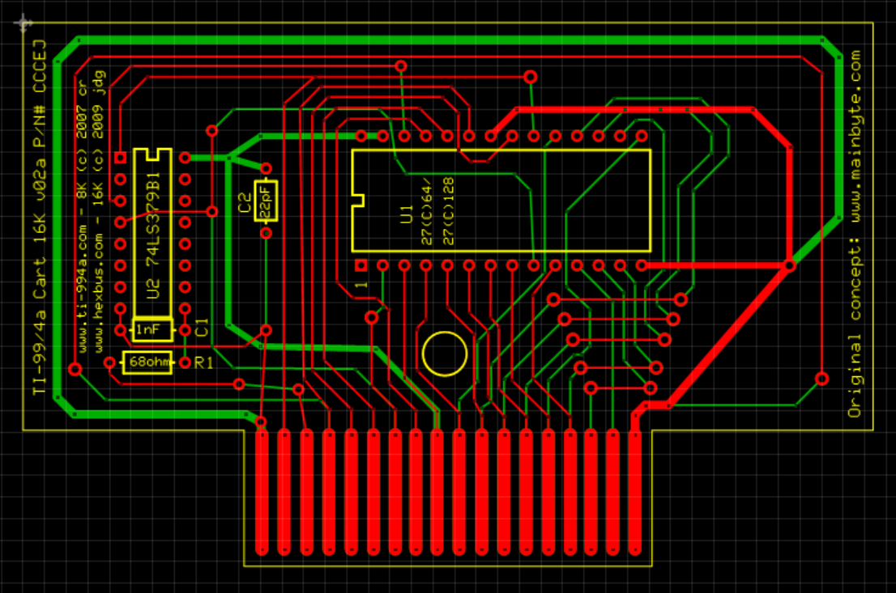
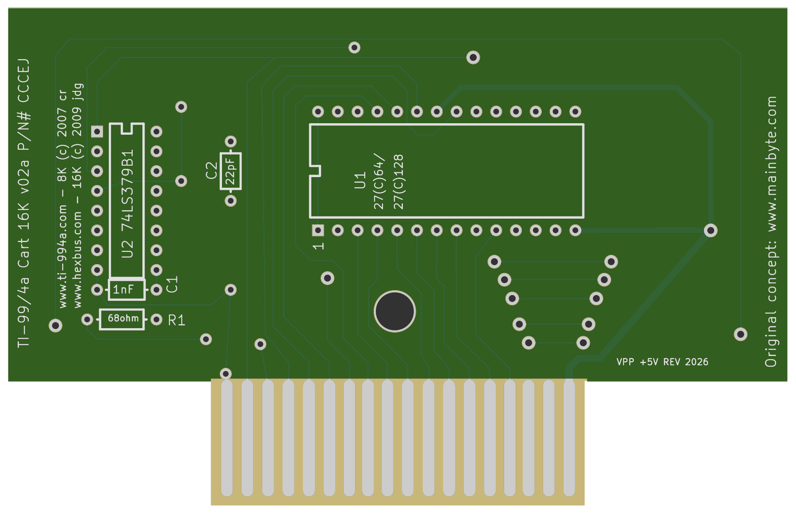
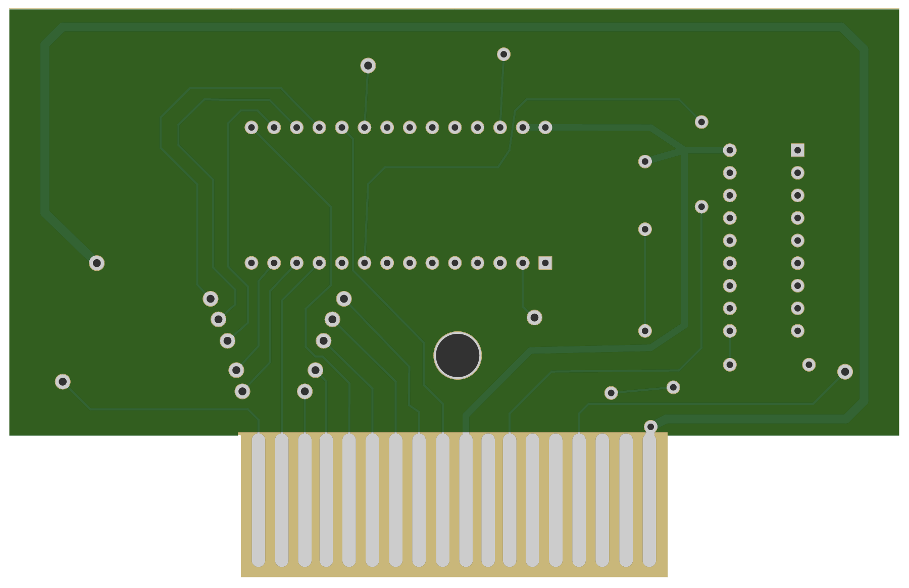

# TI-99/4A 16K Cartridge Board

## PCB ordering

- **[Download the Gerbers — v2a with VPP supply correction, 9 November 2026](https://github.com/hexbus/TI99_16K_Cartridge_Board/raw/refs/heads/main/gerbers/TI99-16K-v2a-VPP-gerbers-20261109.zip)**
- **[Open JLCPCB using my referral link](https://jlcpcb.com/?from=RVDYTTLKZHK)**

Download the Gerber ZIP, open JLCPCB through the referral link, and upload the ZIP directly. It contains both copper layers, both solder-mask layers, top silkscreen, the board outline and plated NC drills. No stencil or assembly files are included.

Confirm **2 copper layers** and an overall outline of **100.0252 × 64.008 mm**, including the connector tongue. The width is slightly greater than 100 mm; do not scale the files to meet a pricing tier. Confirm board thickness, connector contact finish and any bevel requirements for your cartridge socket before ordering; these manufacturing options are not specified in the original source archive.

The referral link does not upload files automatically. I may receive referral rewards for qualifying new users.

## Current fabrication revision

The ExpressPCB v2a artwork was converted to [an editable KiCad 10 PCB](hardware/TI99-16K-v2a-converted.kicad_pcb), with its [project settings](hardware/TI99-16K-v2a-converted.kicad_pro). The [original ExpressPCB archive](16k_cart.zip) remains unchanged for reference.

**The sole electrical change is a 0.254 mm top-layer trace connecting U1 pin 1 (VPP) to pin 28 (+5 V).** The original left pin 1 unconnected. Intel's [M27C128 datasheet](https://deramp.com/downloads/mfe_archive/050-Component%20Specifications/Intel/Memory%20Components/Intel%20M27C128.pdf), read-operation table on page 7-43, permits VPP connected directly to VCC. Program the EPROM separately; this is a read-only cartridge, not an in-circuit programmer. Check the requirements of the actual EPROM you fit.

Original copper, pad positions, outline and hole locations are otherwise preserved. The converted silkscreen uses a different stroke font, retains the original credits, and adds `VPP +5V REV 2026`. The resistor value text was sized to fit its outline. Both original connector mask openings are retained; through-hole pad mask openings extend 0.05 mm beyond the copper.

| Top | Bottom, viewed from underneath |
| --- | --- |
|  |  |

These previews are rendered from the delivered ZIP; colors do not specify a surface finish.

The original IC footprints have 2.54 mm pin pitch: U1 uses 15.24 mm rows and U2 uses 7.62 mm rows, consistent with the [TI 27C128 DIP specification](https://deramp.com/downloads/mfe_archive/050-Component%20Specifications/Texas%20Instruments/Memory%20Components/TI%20TMS27C128.pdf) and [TI 16-pin PDIP drawing](https://www.ti.com/lit/ml/mpdi002c/mpdi002c.pdf). Both notches face left in the top preview; the square pad marks pin 1.

The exact ZIP was checked against the decoded original geometry plus the VPP trace, including copper, outline, all 73 plated drill positions/sizes, mask openings on all through-hole pads, and all 18 connector fingers per side. The added trace clears unrelated copper. Pin-1 orientation and IC supply pins were checked against the Intel and [TI LS379 datasheets](https://www.ti.com/lit/ds/symlink/sn54ls377.pdf). There is no reconstructed schematic/ERC check. DRC retains warnings for intentional shared finger mask openings, open finger ends and the original mounting-circle silk clipped from the export.

**This conversion and VPP revision have not been fabricated or tested.** Cartridge connector mapping/mechanical fit, board thickness, socket and component lead fit, soldering, bank-switch timing and operation still require hardware verification. The ZIP includes checksums, the license and the original README.

## Background
This is the original 16K EPROM Cartridge board for TI-99/4A from www.hexbus.com.  I designed it back in 2009-2010.

## Original README
This 16K .pcb file was made with ExpressPCB (www.expresspcb.com).

You can use and make changes to this file as long as the copyright notices
remain intact on the board and this file is distributed with it.  

This file is (c) 2009 www.hexbus.com, (c) 2007 www.ti-994a.com. Thanks to 
www.mainbyte.com for the idea to make this.

If you make any changes and would like to share them with me, I would love to
see this board continue to improve and become something more....

Jon Guidry

www.hexbus.com

acadiel%guidry.org (replace % with @)

## Usage
See attached license
